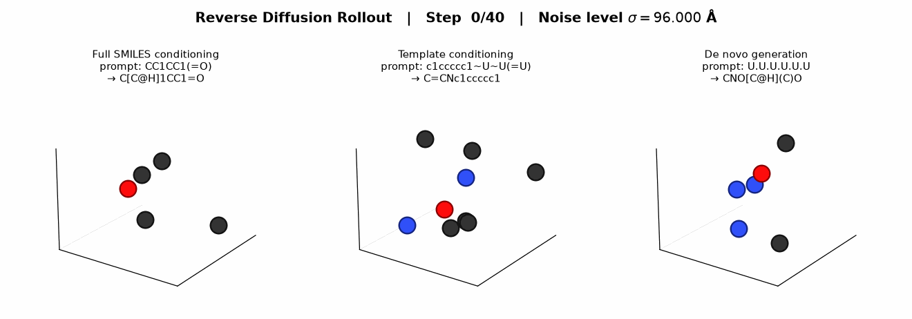

<!-- AGENT NOTICE: Keep this README synchronized with the repository structure, CLI behavior, and modeling pipeline whenever code changes. -->

# miniqm

`miniqm` is a compact JAX, Flax, and Optax implementation of joint 2D+3D molecular diffusion on heavy-atom QM9 graphs (`MAX_ATOMS = 9`).

Instead of using specialized $\mathrm{SE}(3)$-equivariant layers, a standard pair-biased Transformer denoises 3D Cartesian coordinates in $\mathbb{R}^3$, 26-channel one-hot heavy-atom features, and 6-channel one-hot bond features jointly under Karras EDM preconditioning. Per-channel conditioning masks allow the same checkpoint to perform 3D conformer generation from full SMILES, scaffold-constrained 2D+3D completion from partial templates, and unconditional de novo molecule generation.



## Representation & Conditioning

Each QM9 molecule is stripped of explicit hydrogens and padded to $N = 9$ heavy atoms:

* `positions` $\in \mathbb{R}^{N \times 3}$ holds zero-center-of-mass Cartesian coordinates in Angstroms. During training, each molecule is rotated by a uniform random proper rotation $R \in \mathrm{SO}(3)$ sampled via Gram-Schmidt orthogonalization.
* `atom_features` $\in \{0, 1\}^{N \times 26}$ concatenates one-hot blocks for heavy-atom element ($\mathrm{C}, \mathrm{N}, \mathrm{O}, \mathrm{F}$), total degree ($0\text{--}5$), total attached hydrogens ($0\text{--}4$), formal charge ($-1, 0, +1$), hybridization ($\mathrm{sp}, \mathrm{sp}^2, \mathrm{sp}^3, \text{other}$), aromaticity, ring membership, and 3D Cahn-Ingold-Prelog stereochemistry ($\text{none}, R, S$).
* `bond_features` $\in \{0, 1\}^{N \times N \times 6}$ is a symmetric pair tensor encoding bond order ($\text{none}, \text{single}, \text{double}, \text{triple}, \text{aromatic}$) in channels $0\text{--}4$ and ring membership in channel $5$.

Conditioning is controlled by boolean masks `atom_cond_mask` $\in \{0, 1\}^{N \times 26}$ and `bond_cond_mask` $\in \{0, 1\}^{N \times N \times 6}$. Unconditioned channels are replaced with zero in the conditioning input and denoised from Gaussian noise alongside coordinates. During training, each molecule is assigned one of three conditioning regimes:

1. Full 2D graph conditioning ($p = 0.40$), where all atom and bond channels are known and the model predicts 3D conformer coordinates.
2. Partial subgraph conditioning ($p = 0.25$), where a random subset of atoms and incident bonds is masked out.
3. Unconditional generation ($p = 0.35$), where only the valid-atom count mask is given and both the 2D graph and 3D coordinates are denoised from scratch.

At inference time, `collate_smiles` parses SMILES or SMARTS strings into the same mask format using `U` (or `*`) for unconditioned atoms and `~` for unconditioned bonds:

```text
"CCO"               -> full 2D conditioning (conformer generation)
"c1ccccc1~U~U(=U)"  -> phenyl ring fixed; 3 substituent atoms and ~ bonds denoised
"U.U.U.U.U"         -> 5 unconditioned heavy atoms; full 2D+3D de novo generation
```

For full SMILES prompts, `build_conformer_mol` attaches the sampled 3D coordinates directly to the input RDKit graph. For partial or unconditional templates, `build_generated_mol` decodes the continuous bond and atom predictions into a valid valence-consistent RDKit molecule (combining 2D bond logits with interatomic distances to suppress long-range false bonds, enforcing per-atom bond-order capacities, and adjusting elements when needed to satisfy open valences).

## Diffusion Formulation

### Karras EDM Preconditioning

Given noise level $\sigma > 0$ and empirical coordinate standard deviation $\sigma_{\mathrm{data}} = 1.2\text{ \AA}$, the preconditioning coefficients are

$$c_{\mathrm{skip}}(\sigma) = \frac{\sigma_{\mathrm{data}}^2}{\sigma^2 + \sigma_{\mathrm{data}}^2}, \quad c_{\mathrm{out}}(\sigma) = \frac{\sigma \cdot \sigma_{\mathrm{data}}}{\sqrt{\sigma^2 + \sigma_{\mathrm{data}}^2}}, \quad c_{\mathrm{in}}(\sigma) = \frac{1}{\sqrt{\sigma^2 + \sigma_{\mathrm{data}}^2}}, \quad \lambda(\sigma) = \frac{\sigma^2 + \sigma_{\mathrm{data}}^2}{(\sigma \cdot \sigma_{\mathrm{data}})^2}.$$

Training samples $\ln \sigma \sim \mathcal{N}(-1.2, 1.5^2)$ clipped to $[\sigma_{\min}, \sigma_{\max}] = [4\times 10^{-4}, 80.0]\text{ \AA}$, adds independent Gaussian noise $\boldsymbol{\epsilon} \sim \mathcal{N}(\mathbf{0}, \sigma^2 \mathbf{I})$ to coordinates (zero-centered over valid atoms) and to unconditioned atom and symmetric bond channels, and parameterizes the denoiser $D_\theta$ on $z = (\mathbf{x}, \mathbf{a}, \mathbf{b})$ as

$$D_\theta(z_t, \sigma) = c_{\mathrm{skip}}(\sigma)\, z_t + c_{\mathrm{out}}(\sigma)\, F_\theta\!\left(c_{\mathrm{in}}(\sigma)\, z_t,\, \frac{1}{4}\ln \sigma\right).$$

### Pair-Biased Transformer Architecture

$F_\theta$ (`Denoiser` in `src/miniqm/diffusion/model.py`, ~896k parameters at default settings) operates directly on atom tokens $h_i \in \mathbb{R}^{128}$ and pair representations $p_{ij} \in \mathbb{R}^{128}$:

* Atom embeddings sum linear projections of scaled noisy coordinates $c_{\mathrm{in}}(\sigma)\mathbf{x}_i$, scaled noisy atom features, masked ground-truth conditioning features, and the binary conditioning mask.
* Pair embeddings sum linear projections of scaled noisy bond features, conditioned bond features, pairwise coordinate displacements $c_{\mathrm{in}}(\sigma)(\mathbf{x}_i - \mathbf{x}_j)$, and interatomic distances $\|c_{\mathrm{in}}(\sigma)(\mathbf{x}_i - \mathbf{x}_j)\|_2$.
* A sinusoidal Fourier encoder maps $\frac{1}{4}\ln \sigma$ into a conditioning vector that modulates all four pre-norm Transformer blocks via zero-initialized adaptive LayerNorm (`AdaLN`) scale, shift, and residual gates.
* Each Transformer block biases multi-head self-attention logits with a learned projection of $p_{ij}$, updates atom tokens through a gated SiLU MLP, and updates pair representations via outer sums of projected atom tokens before symmetrizing $p_{ij} \leftarrow \frac{1}{2}(p_{ij} + p_{ji})$.
* Output heads project final atom tokens to coordinate updates (re-centered to zero center of mass) and 26-channel atom logits, and project final pair tokens to symmetric 6-channel bond logits.

### Training Loss & Reverse Sampling

The training objective combines four terms weighted by $\lambda(\sigma)$:

$$\mathcal{L} = \mathcal{L}_{\mathrm{coord}} + w_{\mathrm{dist}}\,\mathcal{L}_{\mathrm{dist}} + w_{\mathrm{atom}}\,\mathcal{L}_{\mathrm{atom}} + w_{\mathrm{bond}}\,\mathcal{L}_{\mathrm{bond}}$$

where $\mathcal{L}_{\mathrm{coord}}$ is the EDM-weighted MSE between predicted coordinates $\hat{\mathbf{x}}_0$ and ground-truth coordinates $\mathbf{x}_0^{\mathrm{aligned}}$ rigid-body aligned onto $\mathrm{stop\_gradient}(\hat{\mathbf{x}}_0)$ via Kabsch SVD ($\det R = +1$), $\mathcal{L}_{\mathrm{dist}}$ is an auxiliary MSE on pairwise interatomic distances within $5.0\text{ \AA}$, and $\mathcal{L}_{\mathrm{atom}}, \mathcal{L}_{\mathrm{bond}}$ are EDM-weighted MSE losses on the continuous one-hot atom and bond targets.

At inference time (`src/miniqm/diffusion/sampling.py`), reverse integration steps through the polynomial schedule

$$\sigma_i = \left(\sigma_{\max}^{1/\rho} + \frac{i}{N_{\mathrm{steps}} - 1}\left(\sigma_{\min}^{1/\rho} - \sigma_{\max}^{1/\rho}\right)\right)^\rho, \quad \rho = 7, \quad N_{\mathrm{steps}} = 40$$

using Euler steps with optional Karras stochastic churn ($\gamma_0 = 0.25$ for $\sigma_i \ge 0.1\text{ \AA}$) and re-pinning conditioned 2D channels after the terminal denoising projection.

## Quickstart

Install dependencies with `uv` and download/prepare the QM9 Parquet splits (`data/train.parquet`, `data/validation.parquet`, and `data/test.parquet`):

```bash
uv sync
uv run python data/download_qm9.py
```

### Sampling & Evaluation with Pretrained Weights

Pretrained 100k-step model weights and training logs are stored in `pretrained_weights/`, which `miniqm-sample` and `miniqm-eval` load by default:

```bash
# Sample 3D conformers and 2D+3D molecules from full SMILES, partial templates, or dummy atoms:
uv run miniqm-sample \
    --smiles CCO c1ccccc1 "c1ccccc1~U~U(=U)" "U.U.U.U.U" \
    --num-conformers 5 \
    --output-sdf sampled_conformers.sdf

# Evaluate teacher-forced loss and sampled conformer RMSD / lDDT on the test split:
uv run miniqm-eval --test-path data/test.parquet
```

### Training From Scratch

Launch a training run (by default 100,000 steps with batch size 64 sharded across 8 logical XLA CPU devices, writing checkpoints and logs to `runs/qm9_experiment/<timestamp>/`):

```bash
uv run miniqm-train --run-dir runs/qm9_experiment
```

To evaluate or sample from a custom training run, pass `--run-dir runs/qm9_experiment` (which automatically resolves the latest timestamped run directory).

## Interactive Notebooks

The `notebooks/` directory walks through each stage of the pipeline with 2D RDKit drawings and interactive `py3Dmol` 3D viewers:

* `notebooks/data_source_demo.ipynb` — Loads pre-collated QM9 batches via `DataSource`, inspects heavy-atom count and RMS radius distributions, and plots 2D molecular graphs and bond adjacency matrices.
* `notebooks/geometry_demo.ipynb` — Demonstrates center-of-mass zeroing, uniform random 3D rotations, proper-rotation Kabsch alignment, and mirror-enantiomer chirality preservation.
* `notebooks/diffusion_training_demo.ipynb` — Plots Karras EDM preconditioning curves, trains a denoiser on a single batch to illustrate convergence, and animates 3D reverse-diffusion trajectories.
* `notebooks/evaluation_and_sampling_demo.ipynb` — Loads the pretrained checkpoint from `pretrained_weights/`, plots training/validation curves, evaluates test-set conformer RMSD and lDDT, and animates 3D trajectories for full SMILES (`CCO`), partial templates (`c1ccccc1~U~U(=U)`), and de novo generation (`U.U.U.U.U`).
